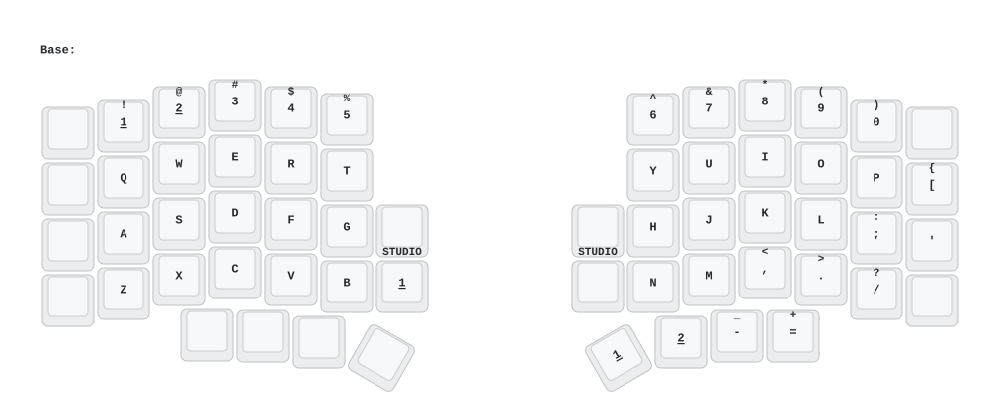
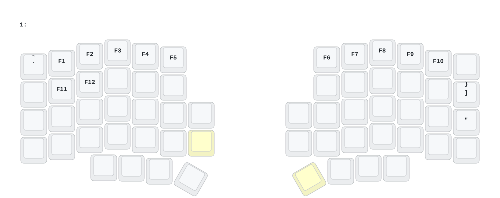

# zmk-config-Haili58

**English** · [简体中文](./README.md)

> **Onboard 128×32 SSD1306 OLED + DYA Studio + ZMK KeyTester**. Built on
> cormoran's ZMK main + Zephyr 4.1 fork (`main+dya`), with per-layer EC11
> encoder bindings editable in DYA Studio. The former `dya` branch has been
> promoted to `main` as the single default branch.

ZMK firmware configuration for the Haili58 wireless split keyboard, integrated
with [DYA Studio](https://studio.dya.cormoran.works/) and
[ZMK KeyTester](https://tangbonze.github.io/zmk-keyboard-tester/?config=https://github.com/tangbonze/zmk-config-Haili58).

## About Haili58

Haili58 is a 60-key wireless split ergonomic keyboard (originally generated by
Shield Wizard for ZMK and adapted to `cormoran/zmk#main+dya`).

Key characteristics:

- **5×12 matrix (30 keys per half)** — 6 columns × 4 rows main block plus 6 bottom / thumb keys per side
- **One EC11 rotary encoder per half** — per-layer bindings editable in DYA Studio (defaults: volume on left, up/down arrows on right)
- **Split wireless + OLED** — nice!nano v2 (`nice_nano//zmk`) and a 128×32 SSD1306 OLED per half, linked over BLE

## Firmware variants

Actions → latest run → Artifacts → `zmk-firmware`, containing these `.uf2` images:

| Artifact | Half | What it is |
| --- | --- | --- |
| `haili58_left_studio` | Left (central) | **Flash this one.** DYA Studio / ZMK Studio + ZMK KeyTester enabled (with `&studio_unlock` guard) |
| `haili58_right` | Right (peripheral) | The peripheral half |
| `haili58_left_studio_unlocked` | Left (central) | Studio without the `&studio_unlock` guard (`CONFIG_ZMK_STUDIO_LOCKING=n`), recovery only |
| `settings_reset_left` / `settings_reset_right` | Left / Right | Wipes stored settings on boot (BLE bonds, runtime macros, Studio keymap, etc.) |

Flash the matching image to each half. After flashing `settings_reset_*`,
flash the normal firmware right over it.

### Studio lock state

The default **`haili58_left_studio` keeps Studio locking enabled**: after
connecting, press either of the two inner bottom-row thumb keys mapped to
`&studio_unlock` in [`config/haili58.keymap`](config/haili58.keymap) before
editing from the browser.

If those unlock keys are unreachable (e.g., an unpopulated or damaged matrix),
temporarily flash `haili58_left_studio_unlocked` for recovery; it disables the
unlock gate so anything plugged into USB can rewrite the keymap, and is not
recommended for daily use.

> Everything the browser writes (keymap, macros, combos, encoder bindings) is
> stored in the keyboard's flash, not in `config/haili58.keymap`. Once ZMK
> Studio has taken over the keymap, edits to `config/haili58.keymap` are
> ignored until you click **Restore Stock Settings** in the UI or flash
> `settings_reset_*` first.

## Left & right half roles

**The left half is central** — both USB and BLE connect to the left half, and
both DYA Studio and ZMK KeyTester talk only to the left half.

| | Left · central | Right · peripheral |
| --- | --- | --- |
| **Which firmware** | **`haili58_left_studio`** | **`haili58_right`** |
| USB / BLE connection | Yes | — |
| Studio RPC | Yes | — |
| Connection mgmt, settings relay | Initiates | Receives & applies |
| Kscan diagnostics, watchdog | Aggregates both halves | Monitors self & reports |
| ZMK KeyTester (Raw HID) | Yes | — |

This is defined in [`boards/shields/haili58/Kconfig.defconfig`](boards/shields/haili58/Kconfig.defconfig)
(`if SHIELD_HAILI58_LEFT → ZMK_SPLIT_ROLE_CENTRAL default y`).

> ⚠️ **Flashing left and right swapped leaves the whole keyboard with no input**
> (central and peripheral cannot pair). Remember: **the half with USB plugged
> in = left = flash `haili58_left_studio`**.

## Keymap

These diagrams are generated by [keymap-drawer](https://github.com/caksoylar/keymap-drawer)
from [`config/haili58.keymap`](config/haili58.keymap) and
[`config/haili58.json`](config/haili58.json), and automatically updated by
[`.github/workflows/keymap_drawer.yml`](.github/workflows/keymap_drawer.yml)
when the keymap changes.

**Base (default layer)**



**Layer 1 (F-keys, symbols & arrows)**



**Layer 2 (navigation)**



Full drawing (all active layers): [`keymap-drawer/haili58.svg`](keymap-drawer/haili58.svg)

## Layer design

| Layer | How to enter | Contents |
| --- | --- | --- |
| 0 `Base` | — | Main 60-key layout; inner two bottom-row keys are `&studio_unlock` |
| 1 `layer_1` | `&mo 1` on bottom row (both halves) | `` ` `` / F1–F12 / `]` / `"` / IJKL arrows (`I`=up, `J`=left, `K`=down, `L`=right) |
| 2 `layer_2` | `&mo 2` on right bottom row | `INS` / `HOME` / `PG_UP` / `PG_DN` / `END` / `PRINTSCREEN` |
| 3–4 `layer_3` / `layer_4` | Enabled in DYA Studio | `status = "reserved"` extra layers ready to activate in the browser |

### Encoders

One EC11 per half, with these defaults:

| | Default fallback (until configured on the web) |
| --- | --- |
| Left encoder (sensor 0) | Volume (`C_VOL_UP` / `C_VOL_DN`) |
| Right encoder (sensor 1) | Up / Down (`UP` / `DOWN`) |

**Encoder bindings can be reconfigured per layer from DYA Studio without
reflashing.** This repo integrates
[cormoran/zmk-behavior-runtime-sensor-rotate](https://github.com/cormoran/zmk-behavior-runtime-sensor-rotate)
and defines one behavior instance per encoder in `config/haili58.keymap`:

```
rsr_left   → sensor 0 (left)   cw-binding = <&kp C_VOL_UP>  ccw-binding = <&kp C_VOL_DN>
rsr_right  → sensor 1 (right)  cw-binding = <&kp UP>        ccw-binding = <&kp DOWN>
```

The `Base` layer uses `sensor-bindings = <&rsr_left &rsr_right>`, while layers
1–4 use `<&rsr_trans &rsr_trans>` (including the `status = "reserved"`
`layer_3` / `layer_4`, so their knobs work once activated in Studio). Rules:

- **Fallback defaults** — until a layer is configured on the web, `rsr_left` /
  `rsr_right` run their default bindings and `&rsr_trans` falls through to `Base`
- **Web wins** — click a knob in DYA Studio's Keymap view to open *Rotary
  Encoder Configuration* and assign per-layer bindings
- **Persistent** — bindings are saved to settings and survive reboots

> ⚠️ Two Kconfig settings in [`config/haili58_left.conf`](config/haili58_left.conf)
> are critical:
> 1. `CONFIG_ZMK_RUNTIME_SENSOR_ROTATE=y` (and `CONFIG_ZMK_RUNTIME_SENSOR_ROTATE_STUDIO_RPC=y`)
>    must stay **central-only (left half)** because the module calls
>    `zmk_behavior_queue_add()`, which ZMK compiles into the central image
>    only. The right half works unmodified as sensor events travel over the
>    split link to central.
> 2. `CONFIG_ZMK_BEHAVIOR_LOCAL_IDS_IN_BINDINGS=y` **must be enabled explicitly**
>    with `CRC16` local IDs (ZMK does not select it automatically); without it,
>    the UI saves cleanly but rotating the knob logs
>    `Failed to find behavior for local_id N` and does nothing.
>
> Keep `CONFIG_EC11=y` and `CONFIG_EC11_TRIGGER_GLOBAL_THREAD=y` in
> [`config/haili58.conf`](config/haili58.conf), or the encoders stop emitting
> events.
>
> The preview coordinates (`dya_encoder_left` / `dya_encoder_right`) in
> [`boards/shields/haili58/haili58.dtsi`](boards/shields/haili58/haili58.dtsi)
> only control where the knobs are drawn in DYA Studio.

## DYA Studio

Open <https://studio.dya.cormoran.works/> in a browser and choose a connection
method on the splash page:

| Method | Description | Supported browsers |
| --- | --- | --- |
| USB | Pick a serial port after plugging in (Web Serial) | Chrome / Edge (desktop) |
| Bluetooth | Connect over BLE after pairing (Web Bluetooth) | Chrome / Edge (desktop), Android Chrome, iOS via Bluefy |
| Demo | Try every UI without a keyboard | same as above |

Firefox and Safari are not supported.

### Supported tabs

| Tab | Status | Module |
| --- | --- | --- |
| Keymap | ✅ | `ZMK_STUDIO` |
| Macro | ✅ | `zmk-feature-runtime-macro` (note the slot in the UI and bind `&rmacro <slot>` in `config/haili58.keymap`) |
| Combo | ✅ | `zmk-feature-runtime-combo` |
| Connection | ✅ (BLE profiles only) | `zmk-module-ble-management` |
| Settings | ✅ (including power management) | `zmk-module-settings-rpc` |
| Troubleshooting | ✅ (device info, watchdog, key matrix) | `zmk-feature-device-info`, `zmk-feature-watchdog`, `zmk-feature-kscan-diagnostics` |
| Trackball | ❌ | No pointing device on this board |

> Optional extras (disabled by default): [`config/west-modules.yml`](config/west-modules.yml)
> documents `zmk-feature-input-stream`, `zmk-feature-default-layer`,
> `zmk-feature-os-detection`, and `zmk-module-devtool`. Uncomment the module and
> add the matching `CONFIG_*` to [`config/haili58_left.conf`](config/haili58_left.conf)
> to enable (`haili58_left_studio` still has ~100 KB of RAM free).

## ZMK KeyTester (Physical Matrix Tester)

This repo integrates the [tangbonze/zmk-matrix-tester](https://github.com/tangbonze/zmk-matrix-tester)
module for hardware-level WebHID physical matrix testing with
[ZMK KeyTester](https://tangbonze.github.io/zmk-keyboard-tester)
(without enabling `CONFIG_ZMK_USB_LOGGING=y`).

1. Connect the left half (central) to your computer via USB (desktop Chrome / Edge).
2. Open the preloaded tester page for this repository:
   <https://tangbonze.github.io/zmk-keyboard-tester/?config=https://github.com/tangbonze/zmk-config-Haili58>
3. Click **WebHID Physical Matrix** at the top and select your keyboard to test every physical switch on both halves, with optional silent intercept mode.

> The module is enabled on the left half (central) only via a dedicated Raw HID
> interface (`HID_1`, `0xFF60 / 0x61`), leaving normal keyboard HID and BLE
> untouched with zero battery impact when unplugged.

## Power management

Configured in [`config/haili58.conf`](config/haili58.conf):

| Setting | State | Effect |
| --- | --- | --- |
| `CONFIG_ZMK_IDLE_TIMEOUT` | 30 s (ZMK default) | OLED blanks; BLE stays connected |
| `CONFIG_ZMK_IDLE_SLEEP_TIMEOUT` | 15 min (`CONFIG_ZMK_SLEEP=y`) | Deep sleep (BLE drops, software power-off) |
| `CONFIG_ZMK_PM_SOFT_OFF` | Enabled, **no key binds `&soft_off`** | Manual soft off |

- **Deep sleep & waking**: skipped while USB is attached; both halves sleep independently on battery, and ZMK has no cross-half wake-up, so **press a key on the left half (central) to wake the keyboard**. DYA Studio's *Settings → Power Management* updates idle/sleep timeouts at runtime (which requires `CONFIG_ZMK_SLEEP=y`, otherwise applying or resetting fails).
- **Soft off**: nothing in `config/haili58.keymap` binds `&soft_off`, so the right half drops the node during build. If you bind `&soft_off`, expect to press the reset button to wake since no `zmk,soft-off-wakeup-sources` node is defined.

## Local build

You need the [Zephyr SDK](https://docs.zephyrproject.org/latest/develop/toolchains/index.html)
and [`west`](https://docs.zephyrproject.org/latest/develop/west/install.html).

**Python 3.12** is required (Zephyr 4.1 does not support 3.13/3.14), plus Zephyr
SDK 0.17.0 (or 0.16.9+):

```bash
brew install python@3.12
python3.12 -m venv .venv && ./.venv/bin/pip install west
export ZEPHYR_SDK_INSTALL_DIR=~/zephyr-sdk-0.17.0

# dependencies land in ./dependencies
west init -l config
west update --narrow
west zephyr-export
# Studio's nanopb generator needs these, or the build fails while generating protos
./.venv/bin/pip install "protobuf>=5.27" grpcio-tools

west zmk-build                                   # build every variant in build.yaml
west zmk-build -a haili58_left_studio            # build just the left Studio firmware
west zmk-build -a haili58_left_studio -p always  # pristine rebuild after config edits

# flashing requires a single variant (--flash errors out with multiple targets)
west zmk-build -a haili58_left_studio --flash

# for debugging, build a firmware with USB logging (costs extra flash)
west zmk-build -a haili58_left_studio -S zmk-usb-logging --flash
```

Firmware lands in `./build/<artifact>/zephyr/zmk.uf2`.

## Troubleshooting

A firmware that compiles is not proof that features are enabled. The classic
case: if none of the DYA Studio Kconfig is loaded, the firmware still builds,
still types after flashing, but the Studio protocol stack was never linked in —
symptom: "can't connect to Studio".

**1. Check the Kconfig warnings in the build log — there should be none.**
Every `assigned the value 'y' but got 'n'` means some feature did not turn on;
the warning carries the symbol name:

```bash
grep -iE "warning: (assigned|attempt to assign|choice symbol)" \
  build/haili58_left_studio/stdout_and_stderr.log
```

**2. Check which `.conf` files the build actually merged.** Confirm both the
shared config and the central-only config were loaded:

```bash
grep -oE "[^ ']*\.conf" build/haili58_left_studio/stdout_and_stderr.log | sort -u
```

The list should include both `config/haili58.conf` and `config/haili58_left.conf`.

**3. Verify the final `.config`.** Every one of these must be `y`; any `n`
means that feature is off (most notably `ZMK_BEHAVIOR_LOCAL_ID_TYPE_CRC16` and
`ZMK_BEHAVIOR_LOCAL_IDS_IN_BINDINGS`, without which encoder bindings configured
in Studio have no effect):

```bash
grep -E "ZMK_STUDIO|PHYSICAL_LAYOUTS|FAST_KEYMAP|KSCAN_DIAG|WATCHDOG|BLE_MANAGEMENT|RUNTIME_(MACRO|COMBO|SENSOR_ROTATE)|DEVICE_INFO|LOCAL_ID_TYPE|LOCAL_IDS_IN_BINDINGS|ZMK_MATRIX_TESTER" \
  build/haili58_left_studio/zephyr/.config | grep -v "=n$"
```

**4. Encoders do nothing** — check `grep EC11 build/haili58_left_studio/zephyr/.config`
shows `CONFIG_EC11=y` and that the encoder node in the overlay has `status = "okay"`.

**5. Capture device logs.** Daily firmware disables `CONFIG_CONSOLE` in
`config/haili58.conf` to save RAM; for debugging, build a logged variant with
`-S zmk-usb-logging`.

**6. No input at all** — first make sure you didn't flash them swapped: the
half with USB plugged in must be `haili58_left_studio` (or `haili58_left_studio_unlocked`).

## Directory layout

```
config/
  haili58.keymap              key definitions (Base / 1 / 2 + 2 reserved layers)
  haili58.json                layout description for external keymap-editor /
                              keymap-drawer (not compiled; DYA Studio uses
                              boards/shields/haili58/haili58-layouts.dtsi)
  haili58.conf                Kconfig shared by both halves (Bluetooth, power
                              management, OLED, EC11, relay plumbing, …)
  haili58_left.conf           left (central) only: Studio RPC, runtime
                              macro/combo/sensor-rotate, ZMK KeyTester
  west.yml                    default west entry point (puts projects in dependencies/)
  west-modules.yml            dependency manifest: ZMK fork + DYA Studio modules + zmk-matrix-tester
boards/shields/haili58/
  Kconfig.defconfig           keyboard name + split role + OLED / LVGL defaults
  Kconfig.shield              shield identity
  haili58.dtsi                matrix transform, EC11 encoders, DYA Studio knob coordinates
  haili58-layouts.dtsi        physical layout (zmk,physical-layout)
  haili58_left.overlay        left matrix pins and I2C OLED
  haili58_right.overlay       right matrix pins and I2C OLED
  haili58.zmk.yml             shield metadata
zephyr/module.yml             tells west / ZMK where to find boards/shields
keymap-drawer/
  haili58.yaml                parsed intermediate YAML generated by keymap-drawer
  haili58.svg                 combined keymap diagram
  layers/                     per-layer standalone SVGs embedded in the README
tools/
  split_keymap_svg.py         splits haili58.svg into keymap-drawer/layers/*.svg
keymap_drawer.config.yaml     keymap-drawer styling and keycode mapping config
.github/workflows/
  build.yml                   builds haili58_left_studio, haili58_left_studio_unlocked, haili58_right, settings_reset
  keymap_drawer.yml           redraws and splits keymap SVGs on keymap changes
build.yaml                    build matrix
```

### Per-half config split & `west.yml` path convention

Because Haili58 defines its own custom shield under `boards/shields/haili58/`
(rather than overriding an upstream built-in ZMK shield), ZMK automatically
layers the shared `config/haili58.conf` and the half-specific
`config/haili58_left.conf` (later file wins):

| File | Scope | Contents |
| --- | --- | --- |
| `boards/shields/haili58/Kconfig.defconfig` | shield | keyboard name, split role, OLED / LVGL defaults |
| `config/haili58_left.conf` | left only | Studio RPC, Runtime Macro / Combo / Sensor Rotate, ZMK KeyTester |
| `config/haili58.conf` | both halves | EC11, sleep / soft off, OLED, `ZMK_SPLIT_RELAY_EVENT`, shared feature modules, stacks |

Meanwhile, [`config/west.yml`](config/west.yml) imports `west-modules.yml`
with `path-prefix: dependencies` so west projects land in `dependencies/`
instead of the repository root — keeping `zephyr/module.yml` isolated from
Zephyr's default `<module root>/zephyr` module loader.

### Measured build sizes

`nice_nano//zmk` (nRF52840; ~792 KB flash available to firmware after the UF2
bootloader). Measured before adding `zmk-matrix-tester`:

| Artifact | RAM | Flash |
| --- | --- | --- |
| `haili58_left_studio` | 160,008 (61.0%) | 487,308 (60.1%) |
| `haili58_left_studio_unlocked` | 159,960 (61.0%) | 487,164 (60.1%) |
| `haili58_right` | 94,788 (36.2%) | 361,772 (44.6%) |
| `settings_reset_left` | 12,848 (4.9%) | 52,604 (6.5%) |
| `settings_reset_right` | 94,788 (36.2%) | 361,868 (44.6%) |

## Dependency source

This configuration does not use ZMK official `main` / `v0.3` but the `main+dya` branch
of [cormoran/zmk](https://github.com/cormoran/zmk) — ZMK main plus the custom
Studio RPC protocol and split relay support DYA Studio needs. **DYA Studio's
extended features depend on this fork**; reverting to official ZMK keeps only
the basic keymap editor.

> ⚠️ cormoran's ZMK fork is an experimental branch tuned for DYA keyboards and
> may contain unstable changes. Fine for personal use, but not recommended where
> high stability matters. The repo runs a weekly build to catch breakage from
> upstream changes.

## License

MIT
