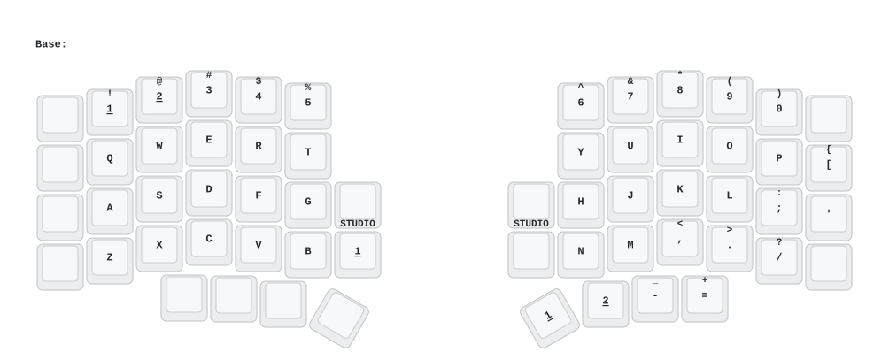
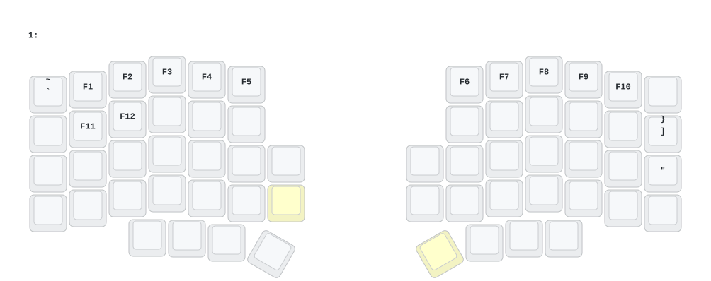

# zmk-config-Haili58

[English](./README.en.md) · **简体中文**

> **板载 128×32 SSD1306 OLED + DYA Studio + ZMK KeyTester**。使用 ZMK main + Zephyr 4.1
> 的 cormoran fork（`main+dya`），每半一枚 EC11 编码器的映射可在 DYA Studio 里按层修改。
> 原 `dya` 分支已合并至 `main` 作为唯一默认分支。

Haili58 无线分体键盘的 ZMK 固件配置，已接入 [DYA Studio](https://studio.dya.cormoran.works/)
与 [ZMK KeyTester](https://tangbonze.github.io/zmk-keyboard-tester/?config=https://github.com/tangbonze/zmk-config-Haili58)。

## 关于 Haili58

Haili58 是一款 60 键无线分体人体工学键盘（由 Shield Wizard for ZMK 生成初始骨架，
现已适配 `cormoran/zmk#main+dya`）。

它的核心特征：

- **5×12 矩阵（每半 30 键）** —— 单侧 6 列 × 4 行主键区 + 底部 6 枚拇指 / 功能键
- **每半一枚 EC11 旋转编码器** —— 支持在 DYA Studio 中按层映射（默认左半音量、右半上下方向键）
- **分体无线 + OLED** —— 每半各一块 nice!nano v2（`nice_nano//zmk`）与 128×32 SSD1306 OLED，左右通过 BLE 配对

## 固件变体

Actions → 最新一次构建 → Artifacts → `zmk-firmware`，内含以下 `.uf2`：

| Artifact | 适用半边 | 说明 |
| --- | --- | --- |
| `haili58_left_studio` | 左手（central） | **日常刷这个。** 启用 DYA Studio / ZMK Studio + ZMK KeyTester（带 `&studio_unlock` 解锁门禁） |
| `haili58_right` | 右手（peripheral） | 外设半边 |
| `haili58_left_studio_unlocked` | 左手（central） | 去掉 `&studio_unlock` 门禁的 Studio 固件（`CONFIG_ZMK_STUDIO_LOCKING=n`），仅作救援用 |
| `settings_reset_left` / `settings_reset_right` | 左手 / 右手 | 启动时清除持久化设置（BLE 配对、运行时宏、Studio 键位等） |

左右半分别刷对应文件。`settings_reset_*` 刷完后再刷回正常固件即可。

### Studio 解锁状态

本仓库默认的 **`haili58_left_studio` 开启了 Studio 锁定保护**：连接后需要先按下
[`config/haili58.keymap`](config/haili58.keymap) 最底行内侧两枚 `&studio_unlock`
拇指键之一才能在网页端改键。

若触发 `&studio_unlock` 的按键失灵（例如矩阵未焊接好），可临时改刷
`haili58_left_studio_unlocked` 进行救援；该镜像去掉了解锁门禁，
任何连上 USB 的设备都可直接改写键位，日常不建议长期使用。

> 浏览器端写入的所有键位、宏与编码器配置都保存在键盘的 flash 中，而不会回写
> `config/haili58.keymap`。一旦 ZMK Studio 接管了键位，之后直接修改
> `config/haili58.keymap` 会被忽略，直到你在界面里点击 **Restore Stock Settings**
> 或先刷入 `settings_reset_*` 清除设置。

## 左右半分配

**本键盘的 central（主控）是左手** —— USB 与 BLE 都接左手，DYA Studio 与 ZMK KeyTester 也只会连上左手。

| | 左手 · central | 右手 · peripheral |
| --- | --- | --- |
| **刷哪个固件** | **`haili58_left_studio`** | **`haili58_right`** |
| USB / BLE 连接 | 是 | — |
| Studio RPC 通信 | 是 | — |
| 连接管理、设置中继 | 发起 | 接收并应用 |
| 抖键诊断、看门狗 | 汇总两半 | 检测本半并上报 |
| ZMK KeyTester（Raw HID） | 是 | — |

这由 [`boards/shields/haili58/Kconfig.defconfig`](boards/shields/haili58/Kconfig.defconfig) 定义
（`if SHIELD_HAILI58_LEFT → ZMK_SPLIT_ROLE_CENTRAL default y`）。

> ⚠️ **刷反了整把键盘会完全没有输入**（central 与 peripheral 配不上）。
> 记住：**插 USB 的那一半 = 左手 = 刷 `haili58_left_studio`**。

## Keymap

以下键位图由 [keymap-drawer](https://github.com/caksoylar/keymap-drawer) 根据
[`config/haili58.keymap`](config/haili58.keymap) 与 [`config/haili58.json`](config/haili58.json)
自动生成，并由 [`.github/workflows/keymap_drawer.yml`](.github/workflows/keymap_drawer.yml)
在修改键位后自动更新。

**Base（默认层）**



**Layer 1（F 键 / 符号 / 方向键层）**



**Layer 2（导航与截图层）**



完整图（含全部已激活层）：[`keymap-drawer/haili58.svg`](keymap-drawer/haili58.svg)

## 图层设计

| 层 | 进入方式 | 内容 |
| --- | --- | --- |
| 0 `Base` | — | 主键区，最底行内侧两枚为 `&studio_unlock` |
| 1 `layer_1` | 左右手最底行 `&mo 1` | `` ` `` / F1–F12 / `]` / `"` / IJKL 方向键（I=上、J=左、K=下、L=右） |
| 2 `layer_2` | 右手最底行 `&mo 2` | `INS` / `HOME` / `PG_UP` / `PG_DN` / `END` / `PRINTSCREEN` |
| 3–4 `layer_3` / `layer_4` | DYA Studio 中启用 | `status = "reserved"` 预留空层，供 Studio 网页端随时激活 |

### 编码器

每半各一枚 EC11，默认配置如下：

| | 默认回落行为（未在网页配置时） |
| --- | --- |
| 左编码器（sensor 0） | 音量（`C_VOL_UP` / `C_VOL_DN`） |
| 右编码器（sensor 1） | 方向上下（`UP` / `DOWN`） |

**编码器映射可以在 DYA Studio 网页上按层实时配置，无需重新编译固件。**
本仓库接入了 [cormoran/zmk-behavior-runtime-sensor-rotate](https://github.com/cormoran/zmk-behavior-runtime-sensor-rotate)，
`keymap` 里为左右编码器各定义了一个行为实例：

```
rsr_left   → sensor 0（左）  cw-binding = <&kp C_VOL_UP>  ccw-binding = <&kp C_VOL_DN>
rsr_right  → sensor 1（右）  cw-binding = <&kp UP>        ccw-binding = <&kp DOWN>
```

Base 层的 `sensor-bindings` 为 `<&rsr_left &rsr_right>`；Layer 1–4 均为
`<&rsr_trans &rsr_trans>`（包括 `status = "reserved"` 的 `layer_3` / `layer_4`，
确保在网页端激活这些预留层后旋钮依然可配置）。行为规则：

- **默认回落**：某层还没在网页上配置过时，`rsr_left` / `rsr_right` 执行上面定义的默认绑定；`&rsr_trans` 则回落到 Base 层
- **网页优先**：在 DYA Studio 键位视图点击旋钮，在 *Rotary Encoder Configuration* 中配置某层后，该层以网页配置为准
- **配置持久化**：绑定写入 settings，重启后保留

> ⚠️ [`config/haili58_left.conf`](config/haili58_left.conf) 中的两项关键 Kconfig 不能删：
> 1. `CONFIG_ZMK_RUNTIME_SENSOR_ROTATE=y`（及 `CONFIG_ZMK_RUNTIME_SENSOR_ROTATE_STUDIO_RPC=y`）必须**只在左手 central** 开启；该模块会调用 `zmk_behavior_queue_add()`，而 ZMK 只将该符号编译进 central 镜像，右手开启会链接报错。右手外设半边无需改动，旋钮事件会通过分体链路转发到 central 处理。
> 2. `CONFIG_ZMK_BEHAVIOR_LOCAL_IDS_IN_BINDINGS=y` **必须显式开启**。本仓库使用 `CRC16` local-ID，ZMK 不会为它自动选中该符号；漏掉后网页读写看似正常，但旋转旋钮只会输出 `Failed to find behavior for local_id N` 而无动作。
>
> 另外 [`config/haili58.conf`](config/haili58.conf) 中的 `CONFIG_EC11=y` 与
> `CONFIG_EC11_TRIGGER_GLOBAL_THREAD=y` 也不能删，否则编码器将不再产生事件。
>
> DYA Studio 界面上两颗旋钮的预览坐标（`dya_encoder_left` / `dya_encoder_right`）定义在
> [`boards/shields/haili58/haili58.dtsi`](boards/shields/haili58/haili58.dtsi) 中，仅用于网页预览绘图，可根据实物位置自行微调。

## DYA Studio

浏览器打开 <https://studio.dya.cormoran.works/>，按 splash 页面选择连接方式：

| 方式 | 说明 | 支持的浏览器 |
| --- | --- | --- |
| USB | 插线后选择串口（Web Serial） | Chrome / Edge（桌面） |
| Bluetooth | 配对后通过 BLE 连接（Web Bluetooth） | Chrome / Edge（桌面）、Android Chrome、iOS 用 Bluefy |
| Demo | 无需键盘，模拟键盘试用全部界面 | 同上 |

Firefox 与 Safari 不支持。

### 支持的功能页

| 功能页 | 状态 | 依赖模块 |
| --- | --- | --- |
| Keymap | ✅ | `ZMK_STUDIO` |
| Macro | ✅ | `zmk-feature-runtime-macro`（网页创建后记下槽位编号，在 keymap 中绑定 `&rmacro <slot>`） |
| Combo | ✅ | `zmk-feature-runtime-combo` |
| Connection | ✅（仅 BLE 配置档） | `zmk-module-ble-management` |
| Settings | ✅（含电源管理） | `zmk-module-settings-rpc` |
| Troubleshooting | ✅（设备信息、看门狗、矩阵诊断） | `zmk-feature-device-info`、`zmk-feature-watchdog`、`zmk-feature-kscan-diagnostics` |
| Trackball | ❌ | 本键盘无轨迹球 / 指点设备 |

> 可选扩展模块（默认未启用）：[`config/west-modules.yml`](config/west-modules.yml) 中已注释列出
> `zmk-feature-input-stream`（实时按键高亮）、`zmk-feature-default-layer`（按端点切换默认层）、
> `zmk-feature-os-detection`（按 OS 自动切换默认层）与 `zmk-module-devtool`（开发调试弹窗）。
> 如需开启，取消对应项目注释并在 [`config/haili58_left.conf`](config/haili58_left.conf)
> 添加相应 `CONFIG_*` 即可；`haili58_left_studio` 尚有约 100 KB RAM 余量。

## ZMK KeyTester（物理矩阵测试）

本仓库已集成 [tangbonze/zmk-matrix-tester](https://github.com/tangbonze/zmk-matrix-tester)
固件模块，配合 [ZMK KeyTester](https://tangbonze.github.io/zmk-keyboard-tester)
网页端可进行硬件级物理矩阵直读测试（无需开启 `CONFIG_ZMK_USB_LOGGING=y`）。

1. 将左手（central）通过 USB 数据线连接到电脑（需桌面版 Chrome / Edge）。
2. 打开预载本仓库配置的在线测试页：
   <https://tangbonze.github.io/zmk-keyboard-tester/?config=https://github.com/tangbonze/zmk-config-Haili58>
3. 点击顶部 **「WebHID 物理矩阵」**，选择你的键盘即可直接点亮左右手任意物理轴体，并支持静默拦截模式防误触。

> 该模块仅在左手（central）启用独立 Raw HID 接口（`HID_1`，`0xFF60 / 0x61`），
> 不干扰标准键盘输出与蓝牙；拔掉 USB 使用电池时零代码执行、不影响深度休眠。

## 电源管理

相关配置位于 [`config/haili58.conf`](config/haili58.conf)：

| 配置项 | 当前状态 | 效果 |
| --- | --- | --- |
| `CONFIG_ZMK_IDLE_TIMEOUT` | 30 秒（ZMK 默认） | 息屏但保持蓝牙连接，首键即响应 |
| `CONFIG_ZMK_IDLE_SLEEP_TIMEOUT` | 15 分钟（`CONFIG_ZMK_SLEEP=y`） | 进入深度休眠（断开蓝牙、彻底断电） |
| `CONFIG_ZMK_PM_SOFT_OFF` | 已编译，未在 keymap 绑定 `&soft_off` | 手动软关机 |

- **深度休眠与唤醒**：插入 USB 时不会休眠；拔线后左右半各自独立计时休眠，且 ZMK 不支持跨半边唤醒，因此休眠后**请按左手（central）任意键唤醒整把键盘**。DYA Studio 的 *Settings → Power Management* 可在运行时修改 idle / sleep 超时并持久化（该面板要求 `CONFIG_ZMK_SLEEP=y`，否则提交和重置都会报错）。
- **Soft Off**：`config/haili58.keymap` 目前未绑定 `&soft_off`，因此右手镜像在编译裁剪时不会包含该行为节点；如需使用，请在 `haili58.keymap` 绑定 `&soft_off`（由于没有配置专用唤醒引脚，软关机后需按复位键开机）。

## 本地构建

需要 [Zephyr SDK](https://docs.zephyrproject.org/latest/develop/toolchains/index.html) 和
[`west`](https://docs.zephyrproject.org/latest/develop/west/install.html)。

需要 **Python 3.12**（Zephyr 4.1 不支持 3.13/3.14）和 Zephyr SDK 0.17.0（或 0.16.9+）：

```bash
brew install python@3.12
python3.12 -m venv .venv && ./.venv/bin/pip install west
export ZEPHYR_SDK_INSTALL_DIR=~/zephyr-sdk-0.17.0

# 依赖下载到 ./dependencies
west init -l config
west update --narrow
west zephyr-export
# Studio 的 nanopb 生成器需要这两个包，否则构建会在生成 proto 时失败
./.venv/bin/pip install "protobuf>=5.27" grpcio-tools

west zmk-build                                   # 构建 build.yaml 里的全部变体
west zmk-build -a haili58_left_studio            # 只构建左手 Studio 固件
west zmk-build -a haili58_left_studio -p always  # 改过配置后建议 pristine 重建

# 烧录必须指定单个变体（多目标时 --flash 会直接报错退出）
west zmk-build -a haili58_left_studio --flash

# 排查问题时编一个带 USB 日志的固件（会多占 flash，日常固件不受影响）
west zmk-build -a haili58_left_studio -S zmk-usb-logging --flash
```

固件输出在 `./build/<artifact>/zephyr/zmk.uf2`。

## 排查

固件能编译通过不代表功能都打开了。最典型的例子：DYA Studio 的全部 Kconfig
如果没被正确加载，固件照样能编过、刷进去也能打字，但 Studio 协议栈压根没被链接进去 ——
表现就是"连不上 Studio"。

**1. 先看构建日志里的 Kconfig warning —— 应为 0 条。** 每条
`assigned the value 'y' but got 'n'` 都意味着某个功能没开，warning 里带符号名：

```bash
grep -iE "warning: (assigned|attempt to assign|choice symbol)" \
  build/haili58_left_studio/stdout_and_stderr.log
```

**2. 确认构建实际合并了哪些 `.conf`。** 检查左手构建是否同时加载了共用配置和左手配置：

```bash
grep -oE "[^ ']*\.conf" build/haili58_left_studio/stdout_and_stderr.log | sort -u
```

正确的输出里应该能同时看到 `config/haili58.conf` 与 `config/haili58_left.conf`。

**3. 核对最终生效的 `.config`。** 下面这些必须全是 `y`，任何一行是 `n`
说明对应功能没打开（最典型的是 `ZMK_BEHAVIOR_LOCAL_ID_TYPE_CRC16` 与
`ZMK_BEHAVIOR_LOCAL_IDS_IN_BINDINGS`，缺少后者会导致编码器网页配置无反应）：

```bash
grep -E "ZMK_STUDIO|PHYSICAL_LAYOUTS|FAST_KEYMAP|KSCAN_DIAG|WATCHDOG|BLE_MANAGEMENT|RUNTIME_(MACRO|COMBO|SENSOR_ROTATE)|DEVICE_INFO|LOCAL_ID_TYPE|LOCAL_IDS_IN_BINDINGS|ZMK_MATRIX_TESTER" \
  build/haili58_left_studio/zephyr/.config | grep -v "=n$"
```

**4. 编码器没反应**，确认 `grep EC11 build/haili58_left_studio/zephyr/.config` 里
`CONFIG_EC11=y`，且 overlay 中对应 encoder 的 `status = "okay"`（已默认开启）。

**5. 抓设备日志。** 日常固件在 `config/haili58.conf` 关了 `CONFIG_CONSOLE` 以省 RAM，
排查时用 `-S zmk-usb-logging` 编一个带日志的版本。

**6. 键盘完全没有输入**，先确认没刷反：插 USB 的那半必须是 `haili58_left_studio`（或 `haili58_left_studio_unlocked`）。

## 目录结构

```
config/
  haili58.keymap              键位定义（Base / 1 / 2 + 2 个 reserved 预留层）
  haili58.json                外部 keymap-editor / keymap-drawer 用的布局描述
                              （不参与编译；DYA Studio 使用 boards/shields/haili58/haili58-layouts.dtsi）
  haili58.conf                两半共用的 Kconfig（蓝牙、电源管理、OLED、EC11、中继基础设施……）
  haili58_left.conf           左手（central）专用 Kconfig（Studio RPC、宏/组合键、编码器映射、ZMK KeyTester）
  west.yml                    默认 west 入口（将依赖放进 dependencies/，避免与 zephyr/module.yml 冲突）
  west-modules.yml            依赖清单：ZMK fork + DYA Studio 模块栈 + zmk-matrix-tester
boards/shields/haili58/
  Kconfig.defconfig           键盘名 + 分体角色 + OLED / LVGL 默认配置
  Kconfig.shield              shield 标识
  haili58.dtsi                矩阵映射、EC11 编码器、DYA Studio 旋钮预览坐标
  haili58-layouts.dtsi        物理键位坐标定义（zmk,physical-layout）
  haili58_left.overlay        左手矩阵引脚与 I2C OLED
  haili58_right.overlay       右手矩阵引脚与 I2C OLED
  haili58.zmk.yml             shield 元数据
zephyr/module.yml             告诉 west / ZMK 在哪里找 boards/shields
keymap-drawer/
  haili58.yaml                keymap-drawer 解析出的中间键位数据
  haili58.svg                 完整键位总图
  layers/                     按层拆分的独立 SVG（供 README 嵌入展示）
tools/
  split_keymap_svg.py         将 haili58.svg 按层拆分为 keymap-drawer/layers/*.svg
keymap_drawer.config.yaml     keymap-drawer 样式与键名映射配置
.github/workflows/
  build.yml                   编译 haili58_left_studio / haili58_left_studio_unlocked / haili58_right / settings_reset
  keymap_drawer.yml           键位变更后自动重绘并拆分 keymap SVG
build.yaml                    构建矩阵
```

### 按半边拆分配置与 `west.yml` 路径约定

Haili58 属于本仓库自带的自定义 shield（位于 `boards/shields/haili58/`），而非 ZMK 上游内置
shield，因此 ZMK 会依次加载两半共用的 `config/haili58.conf` 与各自半边的
`config/haili58_left.conf`（后加载者覆盖前者）：

| 文件 | 作用域 | 放什么 |
| --- | --- | --- |
| `boards/shields/haili58/Kconfig.defconfig` | shield | 键盘名、分体角色、OLED / LVGL 默认值 |
| `config/haili58_left.conf` | 仅左手 | Studio RPC、Runtime Macro / Combo / Sensor Rotate、ZMK KeyTester |
| `config/haili58.conf` | 两半 | EC11、睡眠/软关机、OLED、`ZMK_SPLIT_RELAY_EVENT`、基础特征模块、栈大小 |

同时，[`config/west.yml`](config/west.yml) 通过 `path-prefix: dependencies` 将外部模块克隆到
`dependencies/`，而不是仓库根目录 —— 因为本仓库需要保留 `zephyr/module.yml` 来声明
`board_root`，如果把 Zephyr 直接克隆到根目录，Zephyr 默认的 `<module root>/zephyr` 加载逻辑会撞上仓库里的
`zephyr/` 目录，导致重复 source Kconfig 与重复声明 `zephyr` CMake target。

### 实测构建体积

目标板 `nice_nano//zmk`（nRF52840，UF2 bootloader 留给固件的可用 flash 约为 792 KB）。
以下数据为加入 `zmk-matrix-tester` 前的实测基线：

| Artifact | RAM | Flash |
| --- | --- | --- |
| `haili58_left_studio` | 160,008 (61.0%) | 487,308 (60.1%) |
| `haili58_left_studio_unlocked` | 159,960 (61.0%) | 487,164 (60.1%) |
| `haili58_right` | 94,788 (36.2%) | 361,772 (44.6%) |
| `settings_reset_left` | 12,848 (4.9%) | 52,604 (6.5%) |
| `settings_reset_right` | 94,788 (36.2%) | 361,868 (44.6%) |

## 依赖来源

本仓库不使用 ZMK 官方 `main` / `v0.3`，而是 [cormoran/zmk](https://github.com/cormoran/zmk)
的 `main+dya` 分支 —— 它在 ZMK main 之上加了 DYA Studio 所需的
自定义 Studio RPC 协议与分体中继支持。**DYA Studio 的扩展功能依赖这个 fork**，
换回官方 ZMK 只能保留基础的 keymap 编辑功能。

> ⚠️ cormoran 的 ZMK fork 为实验性分支，针对 DYA 键盘优化，可能包含不稳定的变更。
> 自己用着没问题，但不建议用于需要高稳定性的场合。仓库配置了每周五一次的
> 定时构建，用于监控上游变更带来的破坏。

## License

MIT
